<div align="center">

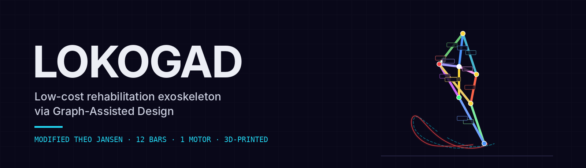

<br>

**A Theo Jansen linkage redesigned for human gait: optimized as a graph, 3D-printed and driven by a single motor.**

[](LICENSE)

[](paper/LOKOGAD.pdf)


[Results](#results) · [How it works](#from-human-gait-to-a-printed-mechanism) · [Prototype](#prototype) · [Installation](#installation) · [Paper](paper/LOKOGAD.pdf) · [Citation](#citation)

</div>

---

<table>
<tr>
<td width="50%">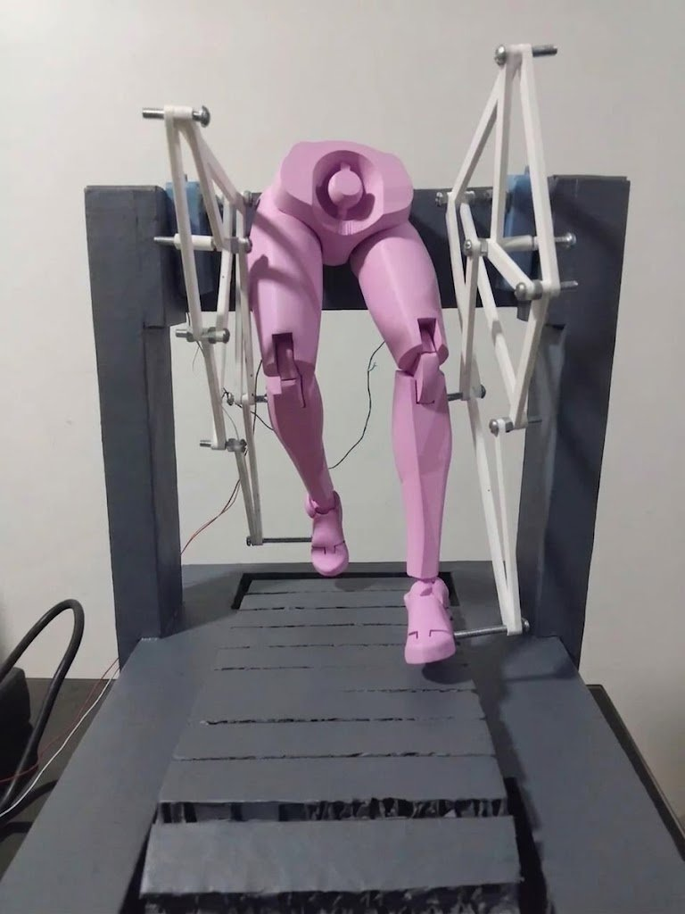</td>
<td width="50%">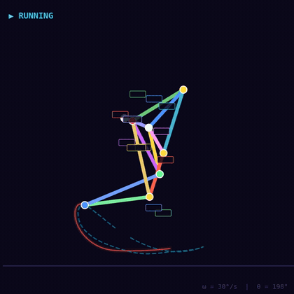</td>
</tr>
<tr>
<td align="center"><sub><b>The printed prototype.</b> PLA/PETG bars, one DC motor per leg.</sub></td>
<td align="center"><sub><b>The optimized mechanism.</b> Foot path (red) against the human reference (dashed).</sub></td>
</tr>
</table>

The classic Theo Jansen linkage was built for quadrupedal walking. LOKOGAD reconfigures it for **human
bipedal gait**: the mechanism is represented as a graph, its kinematics are solved exactly (circle–circle
intersection), its bar lengths are optimized with NSGA-II against reference trajectories from the OpenSim
Gait2392 model, and a topological refinement stage evolves the graph itself.

> **One motor, one degree of freedom, a human-like foot path.** The final 12-bar mechanism was 3D-printed
> (PLA/PETG) and driven by a single DC motor.

<sub>
<b>LOKOGAD: Design of a Low-Cost Rehabilitation Exoskeleton Based on a Modified Theo Jansen Mechanism for
Human Bipedalism via the Graph-Assisted Design Framework</b><br>
Gabriel A. Laurente Caldas, Axel T. Mora Zeña, Diego F. Pantoja Iturrizaga, Jimmy F. León Vásquez —
Faculty of Biomedical Engineering, Universidad Nacional Mayor de San Marcos (UNMSM) ·
<a href="paper/LOKOGAD.pdf">PDF</a>
</sub>

## Highlights

<table>
<tr>
<td width="50%" valign="top">

### 🦵 Human reference gait
Hip, knee and foot trajectories from the OpenSim **Gait2392** model, Fourier-smoothed into reference
tensors.

### 🕸️ Mechanism as a graph
Pivots are nodes, bars are edges. An **exact kinematic solver** (circle–circle intersection) replaces
simulation in the loop.

</td>
<td width="50%" valign="top">

### 🧬 Two-stage optimization
**NSGA-II** on the 13 "Magic Numbers" (10 000 × 500 generations), then **topology evolution** that
adds and removes pivots and bars.

### 🖨️ Ready to print
Collision-free Z-layers over the full crank cycle, print-ready STL with 0.4 mm tolerance, motor coupling
and assembly diagram.

</td>
</tr>
</table>

## From human gait to a printed mechanism

<table>
<tr>
<td width="33%" align="center">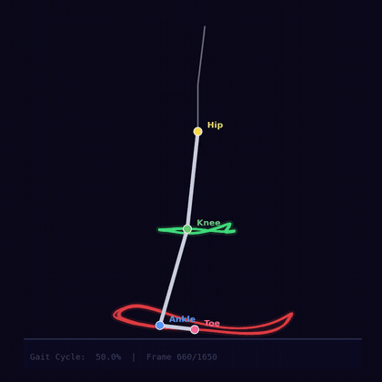</td>
<td width="33%" align="center">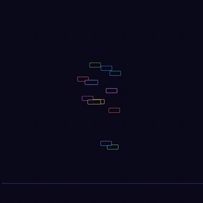</td>
<td width="33%" align="center">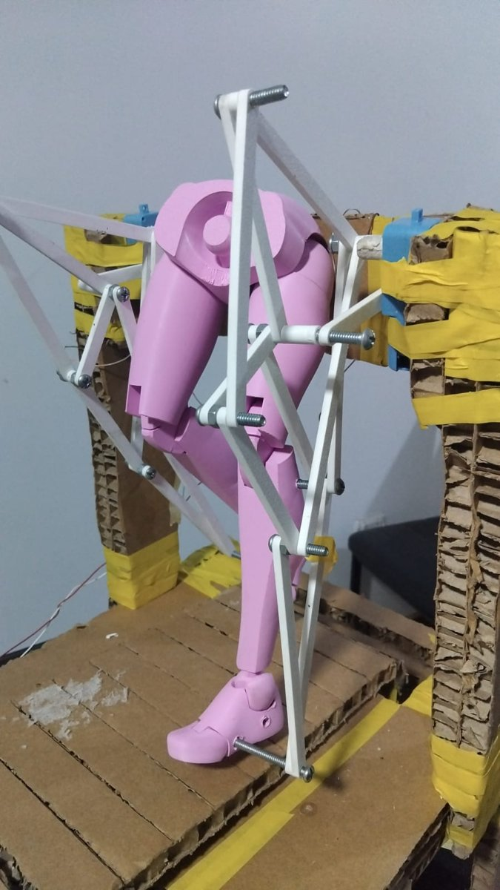</td>
</tr>
<tr>
<td align="center"><sub><b>1 · Reference gait.</b> Hip, knee and toe trajectories from OpenSim Gait2392.</sub></td>
<td align="center"><sub><b>3 · Assembly.</b> The evolved 12-bar linkage, built bar by bar.</sub></td>
<td align="center"><sub><b>4 · Fabrication.</b> Printed bars, pins and motor coupling.</sub></td>
</tr>
</table>

<p align="center">
  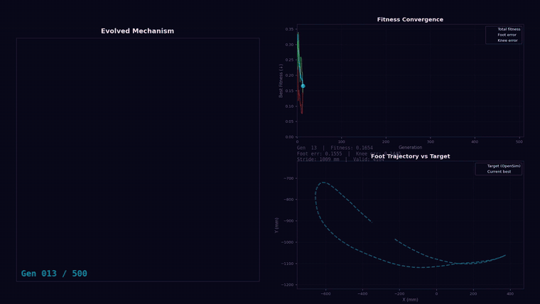
</p>
<p align="center"><sub><b>2 · Evolutionary optimization.</b> The mechanism, its fitness and its foot path converging on the human target over 500 generations.</sub></p>

<sub>Clips from the four-act presentation video → <a href="video/presentation_full.mp4"><code>video/presentation_full.mp4</code></a> (3:50).</sub>

## The mechanism in 3D

<table>
<tr>
<td width="50%">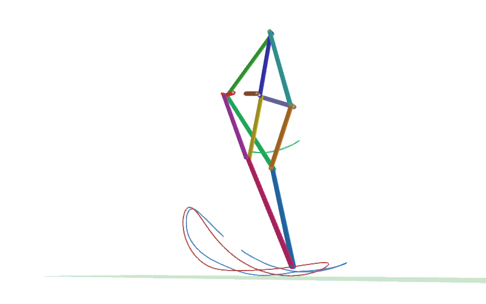</td>
<td width="50%"></td>
</tr>
<tr>
<td align="center"><sub><b>Isometric.</b></sub></td>
<td align="center"><sub><b>360° orbit</b> around the running mechanism.</sub></td>
</tr>
<tr>
<td width="50%"></td>
<td width="50%">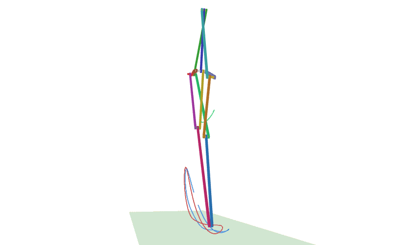</td>
</tr>
<tr>
<td align="center"><sub><b>Lateral (sagittal plane).</b> Foot path (red) vs. human foot (blue) and knee (green).</sub></td>
<td align="center"><sub><b>Frontal.</b> Bars stacked on separate Z-layers.</sub></td>
</tr>
</table>

Open the same scene interactively (rotate, zoom, pan) or re-record the GIFs:

```bash
python visualization/animate_evolved.py        # interactive 3D viewer (--thick for extra-thick bars)
python visualization/record_gait_gifs.py       # writes the four GIFs to visualization/gifs/
```

## Prototype

<table>
<tr>
<td align="center"></td>
<td align="center">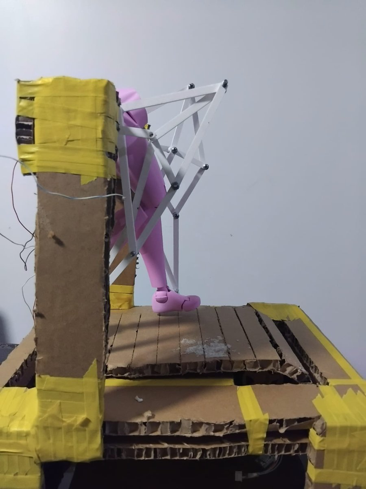</td>
<td align="center"></td>
</tr>
<tr>
<td align="center"><sub><b>Front.</b> One linkage per leg.</sub></td>
<td align="center"><sub><b>Side.</b> The linkage in the sagittal plane.</sub></td>
<td align="center"><sub><b>Three-quarter.</b> Stacked bars and pins.</sub></td>
</tr>
</table>

<details>
<summary><b>Assembly diagram and motor coupling</b></summary>
<br>

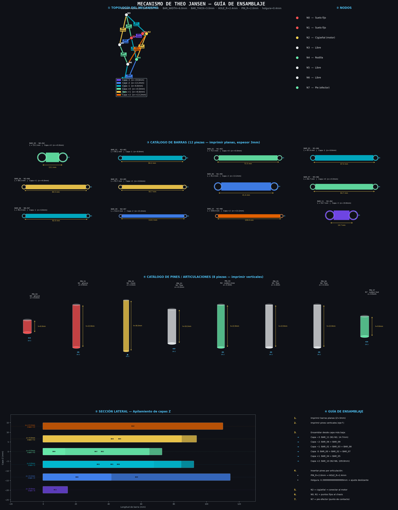

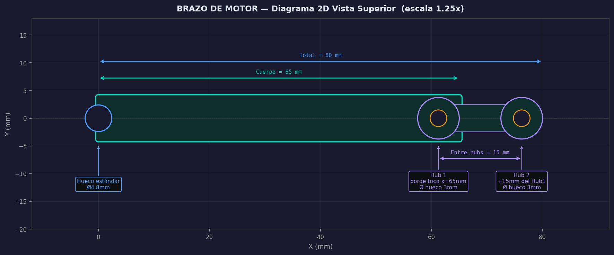

</details>

## Results

<div align="center">

| Metric | Value |
|:---|:---:|
| **Foot** Procrustes error | **4.97 %** |
| **Knee** Procrustes error | 10.79 % |
| Combined fitness | 0.11177 |
| Horizontal foot excursion (human scale) | 966.35 mm |
| Final mechanism | 8 pivots · 12 bars · 6 Z-layers |

</div>

<p align="center">
  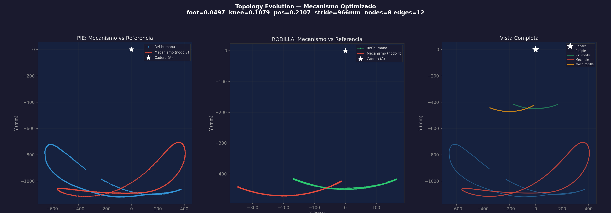
</p>

<details>
<summary><b>Convergence of the topology evolution</b></summary>
<br>

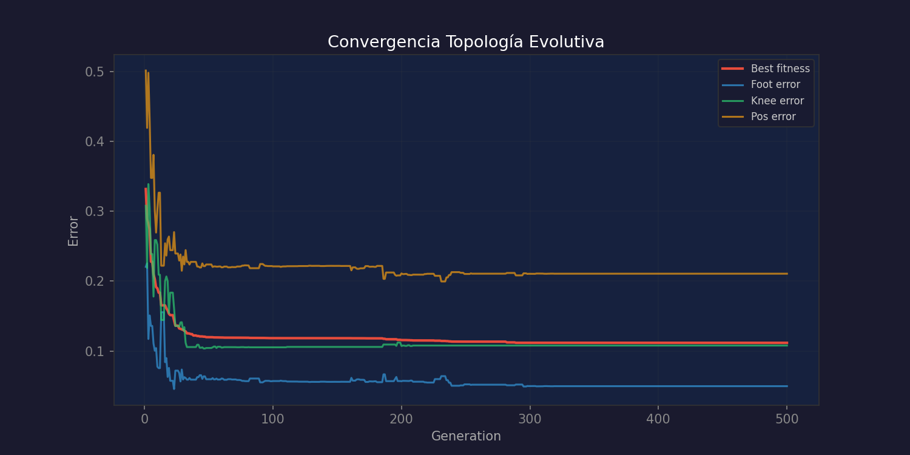

</details>

> [!IMPORTANT]
> **Scope: kinematics only.**
> - ✅ The foot follows the human reference path closely (4.97 % Procrustes error); the knee less so (10.79 %).
> - ⚠️ No force, torque or load criteria were optimized.
> - ⚠️ The prototype was not tested with patients or under load, and its trajectory was not measured.
>
> LOKOGAD is a research prototype, **not a medical device**.

## Pipeline

| Phase | Script | What it does |
|---|---|---|
| 1. Reference gait | `opensim_extraction/extract_gait.py`, `preprocessing/01–03_*.py` | Joint trajectories from OpenSim Gait2392, Fourier smoothing, reference tensors |
| 2. Representation & sampling | `core/linkage_genome.py`, `pipeline/fase1_jansen_dataset.py` | Jansen mechanism as a graph (13 "Magic Numbers"); 10 000-sample tri-modal dataset |
| 2b. Surrogate (optional) | `pipeline/fase2_jansen_gat.py` | GAT surrogate trained on the dataset |
| 3. Optimization | `core/general_solver.py`, `pipeline/fase3_jansen_nsga.py` | Exact kinematic solver + NSGA-II (population 10 000, 500 generations) |
| 3b. Topological refinement | `pipeline/fase3_topology_evo.py` | Graph-level evolution (pivots/bars), yields the final 12-bar mechanism |
| 4. Fabrication | `fabrication/check_and_fix_collisions.py`, `fabrication/export_stl_print_ready*.py` | Swept collision test over 360 crank angles + greedy coloring of the conflict graph (→ `results/z_layers_fixed.json`); Shapely/trimesh STL export with 0.4 mm print tolerance |
| 5. Digital twin | `mechanism/generate_jansen_urdf.py` | URDF model with computed inertial properties |

Configuration (paths, constants) lives in `core/config_jansen.py`; all paths are relative to the repository.

## Installation

```bash
git clone https://github.com/SlightlyDazed/lokogad.git
cd lokogad
python -m venv .venv && source .venv/bin/activate
pip install -r requirements.txt
```

Install PyTorch and PyTorch Geometric for your hardware (CUDA, ROCm or CPU) following their official
instructions. OpenSim is only needed to re-extract the reference gait (phase 1).

## Running

Run every command from the repository root.

```bash
bash run_jansen_pipeline.sh                       # phases 2 → 4 with the paper settings

# or step by step
python pipeline/fase1_jansen_dataset.py --n-samples 10000
python pipeline/fase3_jansen_nsga.py --pop-size 10000 --n-gen 500
python pipeline/fase3_topology_evo.py --n-gen 500
python pipeline/fase4_jansen_export.py --top-n 5
python fabrication/check_and_fix_collisions.py    # collision-free Z layers
python fabrication/export_stl_print_ready.py      # print-ready STL of the final mechanism
```

The reference gait tensors (`opensim_extraction/*_ref_tensor.pt`) are included, so phase 1 is not needed to
run the optimization. To re-extract the gait, clone
[opensim-models](https://github.com/opensim-org/opensim-models) into `opensim_extraction/` (see
`opensim_extraction/setup_opensim.sh`) and run `extract_gait.py`. The scripts in `preprocessing/` expect
`joint_trajectories_opensim.mat`, which is not included in this repository.

<details>
<summary><b>Repository layout</b></summary>

```
core/            shared modules: configuration and paths, linkage genome (graph), exact kinematic solver
pipeline/        fase1 dataset → fase2 GAT surrogate → fase3 NSGA-II → fase3 topology evolution → fase4 export
fabrication/     collision-free Z layers, print-ready STL export, motor-coupling bar, assembly diagram
visualization/   interactive 3D viewers, GIF recorder (gifs/), comparison and gait-snapshot figures
preprocessing/   OpenSim trajectories → Fourier smoothing → reference tensors
opensim_extraction/  gait extraction from OpenSim Gait2392 and the reference tensors used by the optimizer
mechanism/       original Theo Jansen mechanism and URDF generator
snap_joint/      snap-fit joint design (STEP/STL)
video/           four-act presentation video (scripts and presentation_full.mp4)
docs/images/     README images: banner, prototype photos, clips from the presentation video
data/, models/, results/   dataset, trained surrogate, optimization results and print-ready STL
paper/           paper (PDF)
```

</details>

## Citation

If you use this code, please cite the paper (metadata in [`CITATION.cff`](CITATION.cff)):

```bibtex
@article{laurente2026lokogad,
  title  = {LOKOGAD: Design of a Low-Cost Rehabilitation Exoskeleton Based on a Modified Theo Jansen
            Mechanism for Human Bipedalism via the Graph-Assisted Design Framework},
  author = {Laurente Caldas, Gabriel A. and Mora Zeña, Axel T. and Pantoja Iturrizaga, Diego F. and
            León Vásquez, Jimmy F.},
  year   = {2026}
}
```

## License

Code released under the [MIT License](LICENSE). The paper in `paper/` is © its authors.
